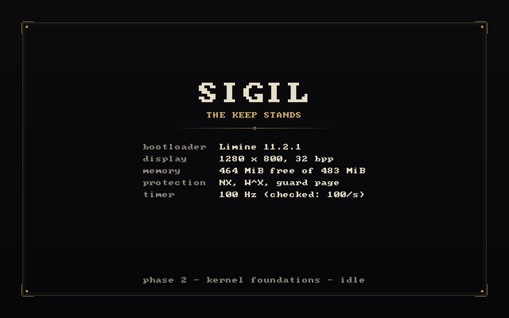
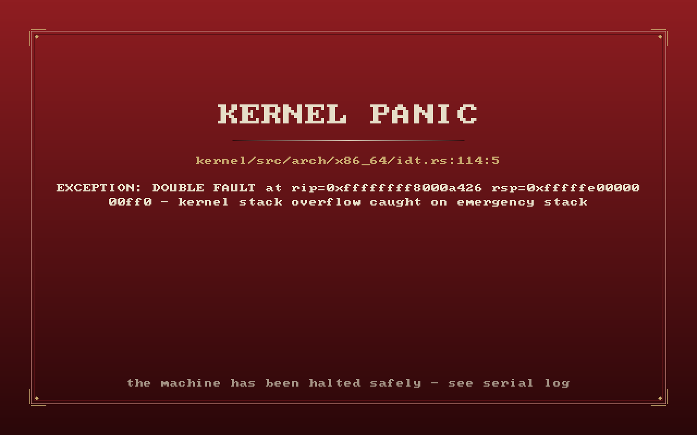

# Hydrogen

An independent operating system built from scratch: its own kernel, drivers, file system,
compositor and a three-realm desktop inspired by cinematic consoles, spatial computing and
medieval dark fantasy.

> Status: **Phase 3 in progress — multitasking** (plan: `docs/PHASE3_PLAN.md`). Phase 2 done: own page
> tables, memory manager, heap, interrupts, timer; CPU faults are caught and reported.
> (Early history used the codename SIGIL.)

| Boot screen | Stack overflow caught |
|---|---|
|  |  |

## Repo map
| Path | What it is |
|---|---|
| `kernel/` | The Rust `no_std` kernel (entry point, serial, framebuffer, panic screen) |
| `boot/limine.conf` | Bootloader menu |
| `Makefile` | Build, run and test targets |
| `tools/` | Test and helper scripts |
| `CLAUDE.md` | Rules the AI assistant follows in this repo |
| `docs/ARCHITECTURE.md` | Kernel, drivers, compositor and app model |
| `docs/DESIGN_SYSTEM.md` | The three realms, art direction, tokens, fonts |
| `docs/ROADMAP.md` | Phases with acceptance tests and results |
| `docs/SAFETY.md` | How we protect the host PC; installed toolchain |
| `docs/HARDWARE_MATRIX.md` | Tested hardware status (honest) |
| `docs/DECISIONS.md` | Decision log |
| `docs/CHAT_MEMORY.md` | Summary of the planning/build sessions: goals, rules, decisions, progress, next steps |
| `design-lab/` | Browser prototype for finding the visual style |

## Build and run
Requires the WSL2 Ubuntu toolchain described in `docs/SAFETY.md`.
From PowerShell in the repo folder:

```powershell
.\tools\wsl.ps1 make test
```

| Command | What it does |
|---|---|
| `make test-all` | Everything below, stops at the first failure |
| `make unit` | Host unit tests for the memory algorithms (`crates/hydrogen-mm`) |
| `make test` | Boot headless for up to 20 s, save `build/test/serial.log` + `frame.png`, pass/fail |
| `make test-panic` | Same with a deliberate panic, checks the crash screen |
| `make test-fault-pagefault` / `-stack` / `-int3` | Deliberate CPU faults: must be caught, never reset |
| `make run` | Boot in a QEMU window (serial log in the terminal) |
| `make debug` | Boot paused with a GDB server on port 1234 |
| `make clean` | Remove build outputs |

The OS only ever runs inside QEMU, booting an ISO file. It never touches real disks.

## Try the Design Lab
Open `design-lab/index.html` in any browser (fonts load from Google Fonts). Keys:
- `Q` / `E` — switch realm (or click the names at the top)
- `←` / `→` — browse cards in Theatre; arrows move through the Satchel in the Keep
- `Z` / `C` — Keep pages (Satchel, Archive, Codex)
- `Tab` or right mouse button (hold) — radial wheel in the Keep, release to invoke
- `T` — style tweaker; **Copy tokens** gives the chosen values back to Claude
